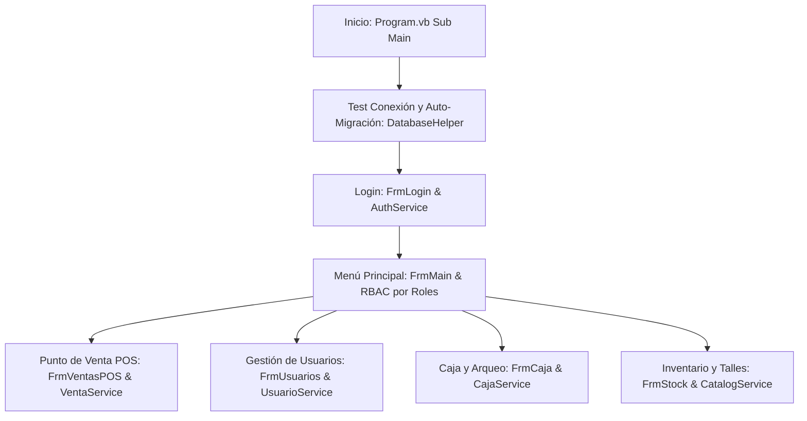
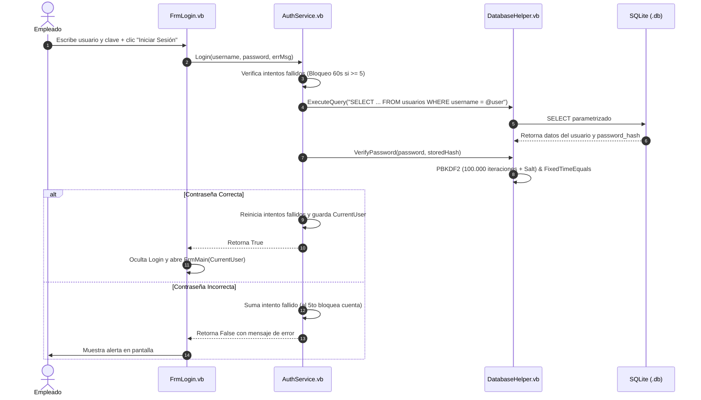
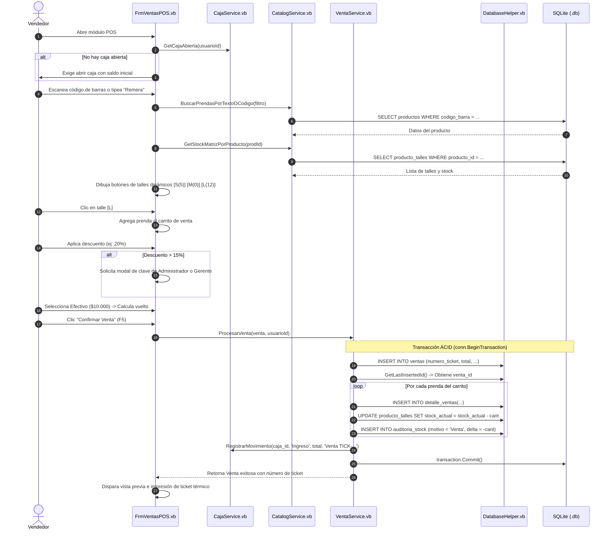

# 🔄 Recorrido Completo Paso a Paso del Sistema
## Cómo interactúan los Formularios, Servicios y Base de Datos en Westside

Este documento explica **el ciclo de vida completo de la aplicación**, desde el milisegundo en que se abre el programa hasta que se procesa una venta, se da de alta un usuario o se cierra la caja del día. 

Está diseñado para que podamos explicar con total claridad técnica **qué archivo se ejecuta, qué función se dispara y cómo viajan los datos** a través de las capas del software.

---

## 🗺️ Mapa Rápido de Flujos Principales



---

## 🚀 Flujo 1: Inicio y Arranque del Software (Bootstrapping)

### ¿Qué pasa cuando le damos doble clic a `GestionComercial.exe`?

1. **Punto de Entrada ([Program.vb](../../GestionComercial/Program.vb) - `Sub Main()`)**:
   * Se inicializan las configuraciones visuales del sistema operativo:
     ```vb
     ApplicationConfiguration.Initialize()
     Application.SetHighDpiMode(HighDpiMode.PerMonitorV2)
     ```
     Esto asegura que en monitores de alta resolución (4K, laptops modernas) las fuentes y ventanas no se vean borrosas.

2. **Verificación de la Base de Datos ([DatabaseHelper.vb](../../GestionComercial/Data/DatabaseHelper.vb) - `TestConnection()` & `GetConnection()`)**:
   * `DatabaseHelper` consulta a [AppConfig.vb](../../GestionComercial/Config/AppConfig.vb) para resolver la ruta del archivo `gestion_comercial.db`.
   * Si la carpeta `Database/` no existe, la crea automáticamente con `Directory.CreateDirectory`.
   * Si el archivo de base de datos no existe físicamente o no tiene tablas creadas:
     * Dispara `InitializeDatabaseAndTables()`.
     * Lee y ejecuta el script [schema_sqlite.sql](../../Database/schema_sqlite.sql) para crear las 12 tablas con sus claves foráneas e índices.
     * Lee y ejecuta [seed_sqlite.sql](../../Database/seed_sqlite.sql) para sembrar los usuarios iniciales (`admin`, `vendedor`, `gerente`), categorías de ropa y talles estándar.

3. **Auto-Migración No Destructiva (`EnsureSchemaUpdates()`)**:
   * Para evitar que una actualización de código rompa bases de datos ya existentes de clientes, ejecuta un `PRAGMA table_info` dinámico.
   * Si detecta que faltan columnas (como `dni` o `fecha_nacimiento`), las agrega al vuelo mediante `ALTER TABLE` sin borrar ningún dato previo.

4. **Lanzamiento de la Pantalla de Login**:
   * Una vez asegurada la persistencia, se instancia y ejecuta:
     ```vb
     Application.Run(New FrmLogin())
     ```

---

## 🔐 Flujo 2: Inicio de Sesión y Control contra Fuerza Bruta

### ¿Qué pasa cuando un empleado escribe su usuario y contraseña?



### Detalle paso a paso en el código:
1. **Captura de Entrada ([FrmLogin.vb](../../GestionComercial/Forms/FrmLogin.vb))**:
   * El botón "Iniciar Sesión" (o la tecla Enter) invoca `BtnLogin_Click`.
   * Valida que ninguno de los dos campos esté vacío.

2. **Evaluación de Seguridad ([AuthService.vb](../../GestionComercial/Services/AuthService.vb) - `Login()`)**:
   * **Control de Fuerza Bruta**: Un diccionario interno protegido con `SyncLock` rastrea cuántas veces falló ese usuario. Si falló 5 veces consecutivas, bloquea el inicio de sesión por 60 segundos completos para frustrar ataques de diccionario automatizados.
   * **Consulta SQL Segura**: Si no está bloqueado, busca el usuario en la base de datos:
     ```vb
     Dim query = "SELECT * FROM `usuarios` WHERE `username` = @user AND `activo` = 1 LIMIT 1;"
     ```
     Usa `AddParam` para prevenir inyecciones SQL.

3. **Verificación Criptográfica ([DatabaseHelper.vb](../../GestionComercial/Data/DatabaseHelper.vb) - `VerifyPassword()`)**:
   * Extrae del hash guardado el algoritmo (`PBKDF2`), la función (`SHA256`), las iteraciones (`100000`) y la sal criptográfica (`Salt` de 16 bytes).
   * Hashea la contraseña tipeada usando exactamente los mismos parámetros con `Rfc2898DeriveBytes`.
   * Compara los dos hashes usando `CryptographicOperations.FixedTimeEquals`: comparación byte a byte en tiempo constante que impide ataques de canal lateral / temporización (*timing attacks*).

4. **Establecimiento de Sesión**:
   * Si la clave coincide, asigna la entidad del empleado a la variable global estática `AuthService.CurrentUser`, actualiza la fecha de `ultimo_login` y cierra el formulario de Login abriendo el menú principal [FrmMain.vb](../../GestionComercial/Forms/FrmMain.vb).

---

## 🏛️ Flujo 3: Menú Principal y Control de Accesos por Rol (RBAC)

### ¿Cómo sabe el sistema qué botones mostrarle a cada persona?

1. **Al cargarse [FrmMain.vb](../../GestionComercial/Forms/FrmMain.vb)**:
   * En `InitializeUI()` se leen los datos del usuario logueado:
     * Nombre y apellido en la esquina superior.
     * Insignia del rol (`Administrador`, `Gerente` o `Vendedor`).

2. **Aplicación de la Matriz de Segregación de Funciones**:
   El código habilita o deshabilita los botones de la barra lateral izquierda según la responsabilidad del rol:

   * **Si es Administrador**:
     * Tiene acceso exclusivo a: **Configuración** (`btnConfiguracion`) y **Usuarios** (`btnUsuarios`).
     * Accede a: **Catálogo de Productos** y **Reportes de Negocio**.
     * **Restricción contable**: Tiene deshabilitados el **Punto de Venta (POS)** y la **Caja Diaria**. Por principio contable de segregación de funciones, quien audita no debe manipular dinero en efectivo.

   * **Si es Gerente**:
     * Supervisa la tienda: opera el **Punto de Venta**, administra la **Caja**, controla el **Stock** de prendas, da de alta productos y autoriza excepciones comerciales (como descuentos mayores al 15%).

   * **Si es Vendedor**:
     * Opera exclusivamente su turno: **Punto de Venta**, **Apertura y Cierre de su Caja**, consulta de catálogo y consulta de clientes.
     * Tiene bloqueado el acceso a configuración y administración de empleados.

---

## 🛒 Flujo 4: Ciclo Completo de una Venta (Desde el Escáner hasta el Ticket)

Este es el flujo neurálgico del comercio. Participan [FrmVentasPOS.vb](../../GestionComercial/Forms/FrmVentasPOS.vb), [CatalogService.vb](../../GestionComercial/Services/CatalogService.vb), [CajaService.vb](../../GestionComercial/Services/CajaService.vb), [VentaService.vb](../../GestionComercial/Services/VentaService.vb) y [DatabaseHelper.vb](../../GestionComercial/Data/DatabaseHelper.vb).



### Detalle de cada paso en este flujo:

1. **Control Preventivo de Caja**:
   * Al abrir el POS, `CajaService.GetCajaAbierta(vendedorId)` consulta si el vendedor ya abrió su turno. Si no lo hizo, el sistema abre automáticamente un diálogo modal exigiendo ingresar el fondo de cambio inicial (ej: `$10.000`), evitando cobros "huérfanos" sin caja asociada.

2. **Búsqueda y Matriz Dinámica de Talles**:
   * El vendedor tipea o escanea con lector láser.
   * `CatalogService.GetStockMatrizPorProducto()` trae el stock discriminado de cada talle.
   * El formulario genera en tiempo real los botones de talle:
     * Si el stock es mayor a 0: botón en color azul/verde seleccionable con cantidad visible (ej: `[M (8)]`).
     * Si el stock es 0: botón deshabilitado en gris/rojo con leyenda `[M (Agotado)]`, impidiendo vender prendas inexistentes.

3. **Política de Descuentos con Autorización Superior**:
   * Si el vendedor intenta aplicar un descuento manual superior al 15%, salta el diálogo de seguridad [AuthService.vb](../../GestionComercial/Services/AuthService.vb) `SolicitarAutorizacionAdminOManager()`.
   * Un Gerente o Administrador debe ingresar su contraseña para autorizar la excepción directamente en el mostrador.

4. **La Transacción Atómica ACID (`VentaService.ProcesarVenta`)**:
   * Todo el cobro se ejecuta bajo un bloque protegido:
     ```vb
     Using trans = conn.BeginTransaction()
     ```
   * **Paso A**: Genera el número correlativo fiscal del ticket (ej: `TICK-20260923-0005`) e inserta la cabecera en `ventas`.
   * **Paso B**: Recupera el ID autoincremental recién creado con `DatabaseHelper.GetLastInsertedId()` (`last_insert_rowid()`).
   * **Paso C**: Recorre cada renglón del carrito:
     * Inserta en `detalle_ventas` guardando el precio histórico del momento (para que si el producto sube mañana, los balances pasados no se alteren).
     * Descuenta las unidades exactas de la combinación talle/color en `producto_talles`.
     * Inserta un asiento de kardex en `auditoria_stock` con tipo `Venta`, registrando qué empleado vendió y qué talle salió.
   * **Paso D**: Si el medio de pago fue Efectivo, inserta un movimiento de ingreso en `movimientos_caja` vinculado a la caja activa del vendedor.
   * **Paso E**: Si todas las operaciones fueron exitosas, se ejecuta `trans.Commit()`. Si falló una sola (por ejemplo, corte de luz o stock insuficiente), se dispara el `Catch` con `trans.Rollback()`, dejando la base de datos 100% limpia sin descuadrar el stock ni la caja.

5. **Impresión del Comprobante Fiscal**:
   * `ConfiguracionService.GetConfiguracion()` lee el nombre del local, CUIT, dirección, teléfono y leyenda de cambios ("Cambios dentro de los 30 días con ticket").
   * Se genera el formato de ticket térmico (58mm / 80mm) con el detalle discriminado de productos, subtotales, método de pago y vuelto entregado.

---

## 👥 Flujo 5: Alta y Gestión de Usuarios (Seguridad y Unicidad de Empleados)

### ¿Qué pasa cuando el Administrador da de alta un nuevo empleado?

1. **Apertura de [FrmUsuarios.vb](../../GestionComercial/Forms/FrmUsuarios.vb)**:
   * Solo accesible por Administrador o Gerente.
   * Carga la grilla completa de empleados llamando a `UsuarioService.GetUsuarios()`.

2. **Ingreso y Validación Preventiva ([UsuarioService.vb](../../GestionComercial/Services/UsuarioService.vb))**:
   * El Administrador completa: DNI, Username, Nombre, Apellido, Rol (`Vendedor`, `Gerente`, `Administrador`) y Contraseña.
   * Antes de tocar la base de datos, el servicio valida:
     * `ExisteUsername(username)`: Evita errores de clave duplicada a nivel usuario.
     * `ExisteDni(dni)`: Evita que dos empleados compartan el mismo documento de identidad.

3. **Encriptación Inmediata con PBKDF2**:
   * La contraseña en texto plano ingresada en la pantalla **nunca** se envía a la base de datos.
   * Se hashea inmediatamente:
     ```vb
     Dim hash = DatabaseHelper.HashPasswordSecure(txtPassword.Text)
     ```
   * Se guarda en la base de datos el hash criptográfico resultante (100.000 iteraciones + Salt).

4. **Baja Lógica (Soft Delete)**:
   * Si un empleado renuncia o es despedido, el Administrador presiona "Dar de Baja".
   * El sistema **no ejecuta un `DELETE` físico**, sino:
     ```vb
     UPDATE usuarios SET activo = 0 WHERE id = @id;
     ```
   * **¿Por qué es crucial para la defensa?**: Si se borrara físicamente al usuario de la tabla, todas las ventas pasadas y los arqueos de caja que esa persona hizo en meses anteriores quedarían con claves foráneas rotas o errores de integridad referencial. Con la baja lógica, el usuario no puede volver a loguearse, pero su nombre sigue intacto en todos los reportes históricos del comercio.

---

## 💵 Flujo 6: Control Diario y Arqueo Ciego de Caja

### ¿Cómo se audita el dinero en efectivo del local?

1. **Apertura de Caja ([FrmCaja.vb](../../GestionComercial/Forms/FrmCaja.vb) & [CajaService.vb](../../GestionComercial/Services/CajaService.vb))**:
   * El cajero inicia el turno e ingresa el monto inicial (ej: `$15.000`).
   * Se inserta un registro en la tabla `cajas` con `fecha_apertura` y `estado = 'Abierta'`.

2. **Movimientos Durante el Día**:
   * Cada venta en efectivo suma automáticamente a esa caja.
   * Si hay que pagar un flete o un proveedor, el cajero usa "Registrar Movimiento" seleccionando tipo `Egreso` y motivo (ej: `"Flete de mercadería - $2.500"`).
   * Se registra en `movimientos_caja` vinculado al ID de la caja.

3. **Cierre y Arqueo Ciego**:
   * Al terminar la jornada, el cajero no ve cuánto dinero "debería" haber (evitando tentaciones de manipular los números).
   * El cajero cuenta los billetes físicos del cajón y escribe el monto real contado (ej: `$84.200`).
   * Al presionar "Cerrar Caja", el sistema calcula:
     $$\text{Monto Esperado} = \text{Saldo Inicial} + \text{Ventas Efectivo} + \text{Ingresos Manuales} - \text{Egresos Manuales}$$
     $$\text{Diferencia} = \text{Monto Real Contado} - \text{Monto Esperado}$$
   * Si la diferencia es `$0`: Caja perfecta.
   * Si la diferencia es positiva: **Sobrante de caja**.
   * Si la diferencia es negativa: **Faltante de caja**.
   * Se actualiza la fila en `cajas` con fecha de cierre, monto final y diferencia, bloqueando la caja para que no admita más operaciones.

---

## 📊 Resumen de Tablas Afectadas por Cada Operación

| Operación que hace el usuario | Tablas de SQLite involucradas | Tipo de Operación |
| :--- | :--- | :--- |
| **Registrar una Venta** | `ventas`, `detalle_ventas`, `producto_talles`, `auditoria_stock`, `movimientos_caja` | `INSERT` + `UPDATE` en transacción ACID |
| **Anular una Venta** | `ventas`, `producto_talles`, `auditoria_stock`, `movimientos_caja` | `UPDATE` estado + restitución de stock + contraasiento de caja |
| **Alta de Prenda / Producto** | `productos`, `producto_talles` | `INSERT` cabecera + UPSERT matriz talles |
| **Ajuste Manual de Stock** | `producto_talles`, `auditoria_stock` | `UPDATE` stock actual + `INSERT` auditoría kardex |
| **Alta de Empleado** | `usuarios` | `INSERT` con hash PBKDF2 |
| **Baja de Empleado** | `usuarios` | `UPDATE activo = 0` (Baja lógica) |
| **Apertura de Caja** | `cajas`, `movimientos_caja` | `INSERT` saldo inicial |
| **Cierre y Arqueo** | `cajas` | `UPDATE` fecha cierre, monto final y diferencia |
| **Guardar Datos del Local** | `configuracion` | `INSERT ... ON CONFLICT(id) DO UPDATE` (UPSERT fila 1) |
